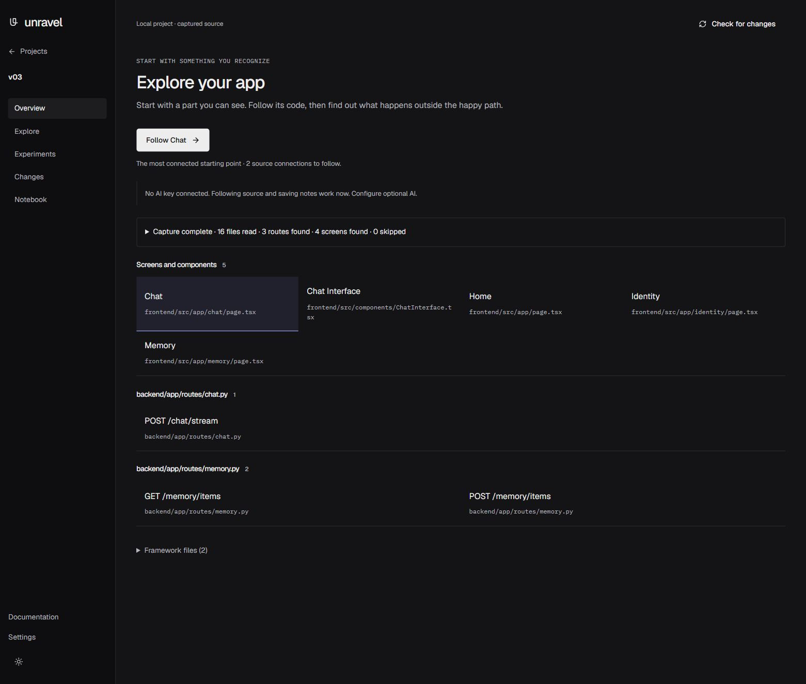

# Unravel




Understand the app you built.

I built Unravel for people who use AI to make software and then need to understand the result. It connects a visible feature to the source that handles it, shows candidate API routes, lets you inspect a prepared failure, and keeps a record of what you learned.

## What it does

Unravel can:

1. Connect a local project folder.
2. Capture readable source files and build a bounded feature map.
3. Show source relationships and candidate backend routes with citations.
4. Let you inspect a prepared Search contract simulation.
5. Run approved local browser checks with disposable data.
6. Save notes and export a discovery as Markdown or JSON.

The maps are static evidence. A matching request and route is an inferred relationship until a browser check records an observation.

## Quick start

The supported route is a source checkout. You need Python 3.12 or later and Node.js 20 or later. From the repository root, install the Python app and frontend dependencies and build the interface:

```bash
python -m pip install -e ".[dev]"
npm ci --prefix web
npm run build --prefix web
```

Open Terminal 1 in the repository root and start the API:

```bash
python -m apps.unravel.cli serve --port 8000
```

Open Terminal 2 in the `web` directory and start Vite:

```bash
npm run dev -- --host 127.0.0.1 --port 5173
```

Open [http://127.0.0.1:5173](http://127.0.0.1:5173). Vite serves the interface and proxies `/api` to the local API. To check the built interface, storage, port and parser, run `python -m apps.unravel.cli doctor` from the repository root.

The prepared demo is also available at `/projects/demo` after the local site starts. It is a browser simulation. It does not contact an AI provider or run a live experiment.

## How it works

The Python API stores projects, snapshots, investigations, discoveries and approved checks in SQLite under `~/.unravel` by default. Tree-sitter reads supported Python, JavaScript and TypeScript syntax. The React interface displays the resulting evidence and keeps prepared demo notes in the browser.

The optional explanation flow uses your own provider key. Unravel sends selected source excerpts and a question only after you give provider consent.

## Local first and privacy

Source capture, storage, notes and prepared demonstrations work without an AI key. The local server listens on `127.0.0.1`. Source files remain in their project folders. Disconnecting a project removes Unravel records and leaves the source folder untouched.

The demo stores notes in the current browser. Live explanation requests can send selected excerpts to Anthropic after consent. Read the [privacy guide](docs/unravel/guides/privacy.md) before enabling a provider.

## Roadmap

1. Improve maps for more framework conventions and dynamic routes.
2. Add more small, source backed examples for local checks.
3. Publish a versioned package after the source installation path stays stable.

## Project layout

`apps/unravel` contains the FastAPI application, source analysis, storage and CLI.

`web` contains the active React and Vite interface.

`docs/unravel` contains product guides, design notes and verification records.

`examples` contains small projects used by the prepared workflows and tests.

## Deploy the prepared site

The Vercel configuration is in `web/vercel.json`. Set the Vercel project root directory to `web` so the rewrite destinations resolve from the frontend build output.

## License

Unravel is released under the [MIT License](LICENSE).
